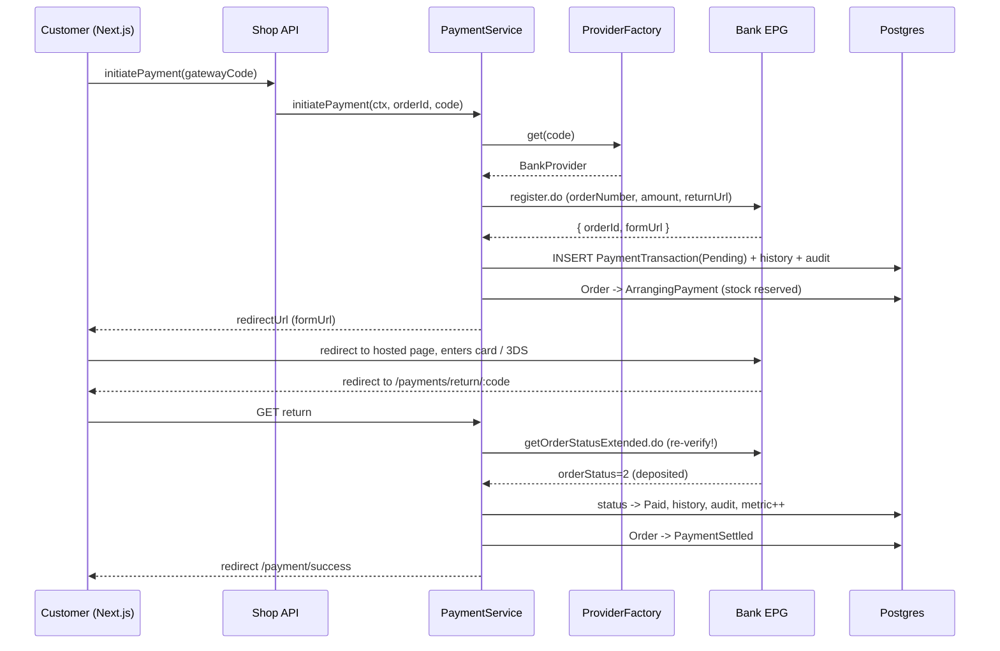
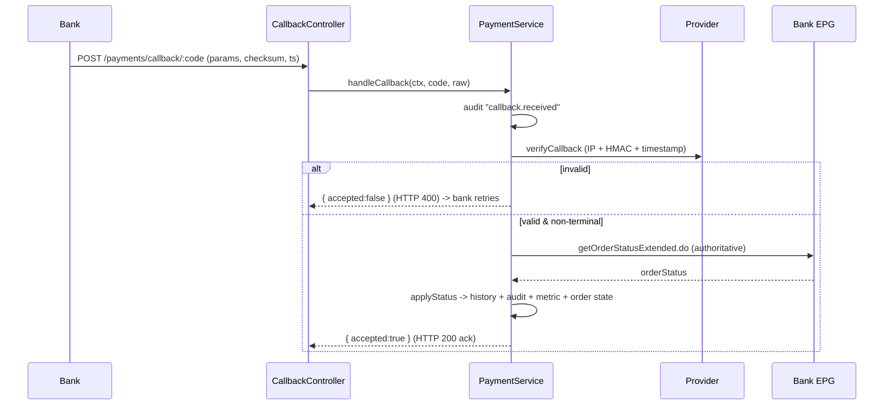
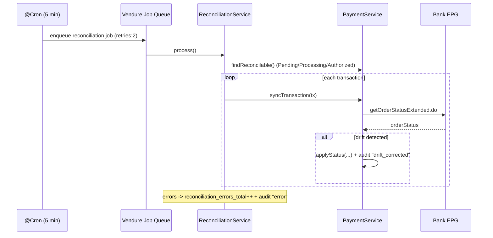

# Online Payment Module — Architecture

Enterprise payment integration for the Homestore Vendure backend. All three
banks — **Halkbank**, **Turkmenturk**, **Rysgal** — run the **BPC SmartVista
E-commerce Payment Gateway (EPG)** REST protocol, which is why a single abstract
provider serves all of them and onboarding a new bank is a configuration task.

---

## 1. Design overview

```
                      ┌──────────────────────────────────────────────┐
   Storefront         │                Vendure backend                │
  (Next.js)           │                                              │
      │ initiatePayment│   ┌───────────────┐    ┌──────────────────┐ │
      ├───────────────►│   │ Shop Resolver │───►│  PaymentService  │ │   ┌────────────┐
      │   redirectUrl  │   └───────────────┘    │  (orchestrator)  │ │   │  Bank EPG  │
      │◄───────────────│                        │                  │ │   │ (SmartVista│
      │                │   ┌───────────────┐    │  ┌────────────┐  │ │   │   REST)    │
   redirect to bank    │   │Admin Resolver │───►│  │  Provider  │──┼─┼──►│            │
      │                │   └───────────────┘    │  │  Factory   │  │ │   └────────────┘
      ▼                │   ┌───────────────┐    │  └─────┬──────┘  │ │         ▲
  bank hosted page     │   │Callback Ctrl  │───►│        │ get(code)│ │         │
      │                │   │ /payments/... │    │  ┌─────▼──────┐  │ │         │
      │ callback/return│   └───────────────┘    │  │ Strategy:  │──┼─┼─────────┘
      └───────────────►│   ┌───────────────┐    │  │ Halkbank / │  │ │  register.do
                       │   │Reconcile Job  │───►│  │ Turkmenturk│  │ │  refund.do …
                       │   │ (every 5 min) │    │  │ / Rysgal   │  │ │
                       │   └───────────────┘    │  └────────────┘  │ │
                       │                        └──────┬───────────┘ │
                       │   Postgres: gateway, transaction, refund,   │
                       │   status_history, audit_log                 │
                       └──────────────────────────────────────────────┘
```

**Patterns**
- **Strategy** — `PaymentProviderInterface` is implemented by `SmartVistaBaseProvider`;
  each bank is a thin subclass overriding only its quirks.
- **Factory** — `PaymentProviderFactory` resolves a strategy by gateway `code`,
  fed by the `PAYMENT_PROVIDER_STRATEGIES` DI multi-token.
- **Dependency Injection** — everything is a Nest provider; the factory and core
  service never reference a concrete bank.

**Adding the 4th…10th bank**
1. `class NewBankProvider extends SmartVistaBaseProvider { readonly code = "newbank"; }`
   (override a `*Endpoint()` or `mapOrderStatus()` hook only if the deployment differs).
2. Add it to the `providers` array and the `PAYMENT_PROVIDER_STRATEGIES` factory in
   `payments.plugin.ts`.
3. Create a `PaymentGateway` row (admin UI) with its URL/credentials.

No change to `PaymentService`, controllers, jobs, schema, or the frontend.

---

## 2. Folder structure

```
src/plugins/payments/
├── payments.plugin.ts              # Vendure plugin wiring (entities, DI, API, perms)
├── constants.ts                    # DI tokens, queue name, cron, defaults
├── types.ts                        # PaymentStatus enum + canonical provider DTOs
├── permissions.ts                  # CrudPermissionDefinition("Payment")
├── providers/
│   ├── payment-provider.interface.ts   # Strategy contract (6 methods)
│   ├── smartvista-base.provider.ts     # Shared SmartVista REST implementation
│   ├── halkbank.provider.ts            # Thin subclass
│   ├── turkmenturk.provider.ts         # Thin subclass
│   ├── rysgal.provider.ts              # Thin subclass (overrides status mapping)
│   └── payment-provider.factory.ts     # code -> strategy resolver
├── entities/
│   ├── payment-gateway.entity.ts
│   ├── payment-transaction.entity.ts
│   ├── payment-refund.entity.ts
│   ├── payment-status-history.entity.ts
│   └── payment-audit-log.entity.ts
├── services/
│   ├── crypto.service.ts               # AES-256-GCM credential encryption
│   ├── payment-gateway.service.ts      # Gateway CRUD + decrypt boundary
│   ├── payment.service.ts              # Lifecycle orchestrator
│   ├── payment-audit.service.ts        # Redacted append-only audit
│   ├── payment-metrics.service.ts      # Prometheus counters
│   ├── payment-report.service.ts       # KPI / chart aggregations
│   └── payment-reconciliation.service.ts  # Job-queue reconciliation worker
├── api/
│   ├── api-extensions.ts               # Shop + Admin GraphQL SDL
│   ├── dto.ts                          # class-validator DTOs
│   ├── payment-shop.resolver.ts        # initiatePayment, paymentStatus
│   ├── payment-admin.resolver.ts       # transactions, gateways, refund, reports
│   ├── payment-callback.controller.ts  # POST callback / GET return
│   └── payment-metrics.controller.ts   # /payments/metrics, /payments/health
└── docs/
    └── ARCHITECTURE.md
```

---

## 3. Payment lifecycle & status mapping

Internal `PaymentStatus` is decoupled from both the bank's numeric `orderStatus`
and Vendure's order state machine.

| SmartVista `orderStatus` | Internal `PaymentStatus` | Vendure Order state |
|---|---|---|
| 0 registered, not paid | `Pending` | `ArrangingPayment` |
| 5 auth via ACS (3DS)   | `Processing` | `ArrangingPayment` |
| 1 preauth hold         | `Authorized` | `ArrangingPayment` |
| 2 deposited            | `Paid` | `PaymentSettled` |
| 6 declined             | `Failed` | `Cancelled` (stock released) |
| 3 reversed             | `Cancelled` | `Cancelled` |
| 4 refunded             | `Refunded` / `PartiallyRefunded` | — |
| (expired locally)      | `Expired` | `Cancelled` (stock released) |

**Stock reservation** — Vendure reserves stock when the order is placed /
transitions into `ArrangingPayment`. On `Failed`/`Expired`/`Cancelled` the order
is transitioned to `Cancelled`, releasing the allocation. Expiry is enforced by
the reconciliation worker against `PaymentTransaction.expiresAt`
(default **15 min**, configurable per gateway).

---

## 4. Sequence diagrams

### 4.1 Checkout → payment → settlement



### 4.2 Server-to-server callback (untrusted → verified)



### 4.3 Scheduled reconciliation



---

## 5. Database schema

```
payment_gateway (
  id PK, name, code UNIQUE, enabled bool,
  credentials jsonb (AES-256-GCM envelope), configuration jsonb,
  createdAt, updatedAt )

payment_transaction (
  id PK, orderId FK->order, customerId FK->customer NULL,
  gatewayId FK->payment_gateway,
  externalTransactionId (idx), idempotencyKey UNIQUE,
  amount int (minor units), currency, status (idx),
  expiresAt, refundedAmount int,
  requestPayload jsonb, responsePayload jsonb, callbackPayload jsonb,
  createdAt, updatedAt )
  INDEX (status), (gatewayId,status)

payment_refund (
  id PK, paymentTransactionId FK->payment_transaction,
  amount int, reason, status, externalRefundId, initiatedBy,
  responsePayload jsonb, createdAt, updatedAt )

payment_status_history (
  id PK, paymentTransactionId FK (idx),
  oldStatus NULL, newStatus, source, notes, createdAt, updatedAt )

payment_audit_log (
  id PK, action (idx), paymentTransactionId NULL (idx),
  actor, sourceIp, payload jsonb (secrets redacted), createdAt, updatedAt )
```

Generate the migration after building:
```bash
npm run build
npx vendure migrate            # or: npx ts-node ... generate Payments
```

---

## 6. API endpoints

**Shop GraphQL**
- `query availablePaymentGateways: { onlinePaymentEnabled, gateways[] }` — global
  switch + enabled gateways in `displayOrder`; empty when the master switch is off
- `mutation initiatePayment(gatewayCode): InitiatePaymentResult!` (rejects when disabled)
- `query paymentStatus(transactionId): PaymentStatusResult` (polled every 5 s)

**Admin GraphQL** (gated by `Payment` permission)
- `query paymentTransactions(filter)` / `paymentTransaction(id)`
- `query paymentGateways` / `paymentKpis(dateFrom,dateTo)` / `systemPaymentSettings`
- `mutation createPaymentGateway / updatePaymentGateway`
- `mutation setPaymentGatewayEnabled(code, enabled)` — individual on/off
- `mutation reorderPaymentGateways(orderedCodes)` — display order
- `mutation testPaymentGatewayConnection(code): { ok, message }`
- `mutation setOnlinePaymentEnabled(enabled)` — global master switch
- `mutation refundPaymentTransaction(transactionId, amount, reason)`
- `mutation cancelPaymentTransaction(transactionId)`
- `mutation runPaymentReconciliation`

**REST (controllers)**
- `POST /payments/callback/:gatewayCode` — bank notification
- `GET  /payments/return/:gatewayCode`   — browser return → storefront redirect
- `GET  /payments/metrics`               — Prometheus exposition
- `GET  /payments/health`                — liveness + open-payment backlog

---

## 7. Security architecture

| Requirement | Implementation |
|---|---|
| Encrypt credentials | `CryptoService` AES-256-GCM; only `CryptoService` ever decrypts |
| Secrets in env | 32-byte master key in `PAYMENTS_ENCRYPTION_KEY`; bank user/pass in DB ciphertext |
| Callback signature | `verifyCallback` HMAC-SHA256 over sorted params (when `callbackSecret` set) |
| Replay protection | timestamp tolerance window + idempotent terminal-state short-circuit |
| Timestamp validation | `CALLBACK_TIMESTAMP_TOLERANCE_MS` (5 min) |
| IP whitelist | per-gateway `ipWhitelist`, enforced before signature |
| Idempotency | unique `idempotencyKey` per transaction; re-init reuses open txn |
| Never trust redirect | always re-verify via `getOrderStatusExtended.do` before mutating order |
| Input/DTO validation | `class-validator` DTOs + GraphQL schema types |
| CSRF | shop mutations use Vendure session/bearer auth; callbacks are signature-gated, not cookie-trusted |
| Audit logging | `PaymentAuditService` append-only, secrets redacted |
| Rate limiting | apply at reverse proxy / Nest guard on `/payments/callback/*` (see §9) |
| Structured logging | Vendure `Logger` with `loggerCtx` on every external call |

---

## 8. Observability

- **Metrics** (`PaymentMetricsService`, exposed at `/payments/metrics`):
  `payment_success_total`, `payment_failed_total`, `payment_refund_total`,
  `reconciliation_errors_total` (labelled by gateway/reason).
- **Health** `/payments/health` returns `degraded` (503) when the open-payment
  backlog crosses threshold — a proxy for stuck callbacks.
- **OpenTelemetry** — wrap `SmartVistaBaseProvider.call()` in a span and register
  the OTEL SDK at bootstrap; every external bank call is already centralised there.

---

## 9. Production deployment considerations

- **Key management**: load `PAYMENTS_ENCRYPTION_KEY` from a secrets manager
  (Vault/KMS), not `.env`. Plan key rotation (envelope versioned via `v:1`).
- **Worker topology**: run the reconciliation job on the Vendure *worker*
  process; the `@Cron` trigger only enqueues, so it is safe with multiple web
  replicas (single enqueue per tick) — pin the cron to the worker or guard with
  an advisory lock if web instances also schedule.
- **Idempotency under retries**: callbacks + job retries are safe because
  terminal states short-circuit and status transitions are funnelled through
  `applyStatus`.
- **Network egress**: allowlist each bank's EPG host; set tight `timeoutMs`.
- **Callback ingress**: terminate TLS at the proxy, restrict
  `/payments/callback/*` by source IP at the edge AND per-gateway whitelist,
  add rate limiting (e.g. nginx `limit_req`) and a Nest throttler guard.
- **DB**: the jsonb payload columns grow; partition/retain `payment_audit_log`
  and archive old `payment_status_history`.
- **Money**: all amounts are integer minor units end-to-end — no floats.
- **Migrations**: never `synchronize` in prod; ship generated migrations.
- **Secrets in logs**: audit payloads and `Logger` calls never include
  credentials (redaction in `PaymentAuditService`).

---

## 10. Configuration

`.env`:
```
PAYMENTS_ENCRYPTION_KEY=<64 hex chars / 32-byte base64>
STOREFRONT_URL=https://shop.homestore.tm
```

Per-gateway `configuration` JSON (non-secret):
```json
{
  "baseUrl": "https://epg.halkbank.tm",
  "basePath": "/payment/rest/",
  "defaultCurrencyCode": "934",
  "twoPhase": false,
  "timeoutMs": 15000,
  "expirationMinutes": 15,
  "returnUrl": "https://api.homestore.tm/payments/return/halkbank",
  "ipWhitelist": ["10.7.32.60"]
}
```
Credentials (encrypted): `{ "userName": "...", "password": "...", "callbackSecret": "..." }`.
```
