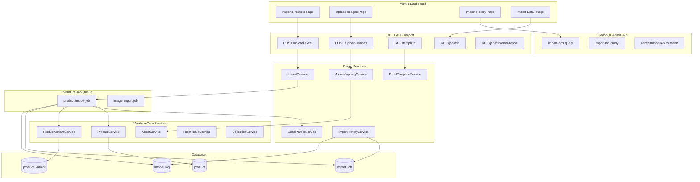
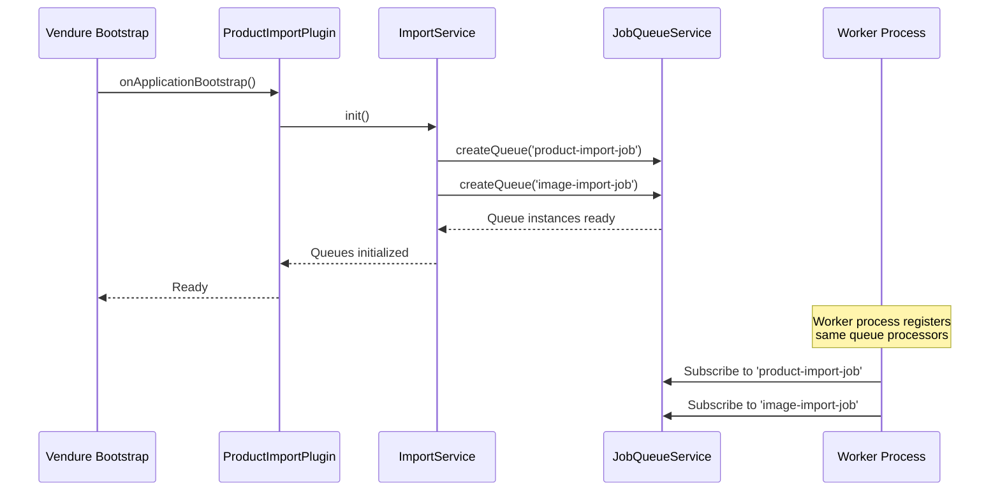

# Vendure Product Import Plugin

> Enterprise-grade Excel product import and bulk image mapping for Vendure 3.x

---

## Table of Contents

- [Overview](#overview)
- [Features](#features)
- [Quick Start](#quick-start)
- [Documentation Index](#documentation-index)
- [Architecture Overview](#architecture-overview)
- [Plugin Lifecycle](#plugin-lifecycle)
- [Supported Workflows](#supported-workflows)

---

## Overview

The **Product Import Plugin** provides a complete bulk-import pipeline for the Vendure headless commerce platform. It enables administrators to import thousands of products and variants from Microsoft Excel files, automatically map product images by SKU filename convention, track every import operation with detailed logs, and recover gracefully from partial failures — all without touching application code or the Vendure Admin CLI.

The system is designed for enterprise catalogs: it handles 100 k+ rows through batched database writes and Vendure's built-in job queue, streams large XLSX files to avoid memory exhaustion, and keeps a permanent audit trail of every import operation.

---

## Features

| Category | Capability |
|---|---|
| **Excel Import** | Upload `.xlsx` / `.xls` files up to 100 MB |
| **Import Modes** | `CREATE`, `UPDATE`, `UPSERT` |
| **Dry Run** | Full validation without database writes |
| **Image Mapping** | Automatic SKU → image matching from ZIP or individual files |
| **Background Jobs** | Non-blocking queue processing via Vendure Job Queue |
| **Progress Tracking** | Real-time progress polling from the dashboard |
| **Import History** | Permanent per-job audit log with per-row status |
| **Excel Error Reports** | Colour-coded multi-sheet `.xlsx` report + JSON error report |
| **Auto Slug Generation** | Slug optional — auto-generated from product name + SKU with collision handling |
| **Template Generator** | Dynamic XLSX template with hints, dropdowns, and examples |
| **Admin Dashboard** | Four new dashboard pages with drag-and-drop UI |
| **REST Endpoints** | Multipart file upload endpoints alongside GraphQL |
| **Facet Mapping** | Resolve `facet:value` pairs to existing FacetValues |
| **Collection Mapping** | Resolve collection slugs during import |
| **Custom Fields** | Map `customField_*` columns to Vendure custom fields |
| **SEO Fields** | Import `metaTitle` / `metaDescription` per product |

---

## Quick Start

### 1. Install dependencies

```bash
npm install exceljs adm-zip @nestjs/platform-express multer
npm install --save-dev @types/adm-zip @types/multer
```

### 2. Register plugin

```typescript
// src/vendure-config.ts
import { ProductImportPlugin } from './plugins/product-import/product-import.plugin';

export const config: VendureConfig = {
  plugins: [
    // ... other plugins
    ProductImportPlugin.init({}),
  ],
};
```

### 3. Run migration

```bash
npm run migration:run
```

### 4. Start server

```bash
npm run dev
```

### 5. Open Dashboard

Navigate to **Catalog → Import Products** in the Vendure Admin Dashboard.

---

## Documentation Index

| Document | Audience | Description |
|---|---|---|
| [Installation Guide](./installation.md) | Developer | Full setup, prerequisites, env vars |
| [Configuration Reference](./configuration.md) | Developer | All plugin options with examples |
| [Admin User Guide](./admin-guide.md) | Admin / Operator | Step-by-step import walkthroughs |
| [Excel Template Reference](./excel-template.md) | Admin / Developer | Every column documented |
| [Slug Generation Guide](./slug-generation.md) | Developer | Auto-generation, collision handling, Unicode |
| [Import Reports Guide](./import-reports.md) | Admin / Developer | Excel + JSON reports, how to act on them |
| [Image Mapping Guide](./image-mapping.md) | Admin / Developer | Filename conventions, ZIP handling |
| [API Reference](./api-reference.md) | Developer | GraphQL + REST endpoints |
| [Architecture Guide](./architecture.md) | Developer | Services, queue, pipeline diagrams |
| [Database Reference](./database.md) | Developer / DBA | Entities, ER diagram, indexes |
| [Performance Guide](./performance.md) | Developer / DevOps | Scaling to 100 k+ rows |
| [Security Guide](./security.md) | Developer / Security | File validation, access control |
| [DevOps Guide](./devops.md) | DevOps | Docker, Kubernetes, Nginx, PM2 |
| [Troubleshooting Guide](./troubleshooting.md) | Developer / Support | Common errors and solutions |
| [Testing Guide](./testing.md) | Developer | Unit, integration, E2E testing |
| [Maintenance Guide](./maintenance.md) | DevOps / Developer | Updates, cleanup, monitoring |

---

## Architecture Overview



---

## Plugin Lifecycle



---

## Supported Workflows

### Workflow 1 — New Catalog Import

```
Download Template → Fill Data → Upload Excel (CREATE mode) → Monitor Progress → Review Logs
```

### Workflow 2 — Price / Stock Update

```
Export current SKUs → Update price/stock columns → Upload Excel (UPDATE mode) → Verify changes
```

### Workflow 3 — Upsert Mixed Catalog

```
Prepare Excel with new + existing SKUs → Upload (UPSERT mode) → New rows created, existing updated
```

### Workflow 4 — Bulk Image Upload

```
Name images after SKU → Zip all images → Upload ZIP → System maps images to products automatically
```

### Workflow 5 — Validate Before Import

```
Prepare Excel → Upload with Dry Run enabled → Review validation errors → Fix issues → Re-upload
```

### Workflow 6 — Incremental Updates

```
Export changed SKUs → Update fields → Upload (UPDATE mode) → Only modified records touched
```
