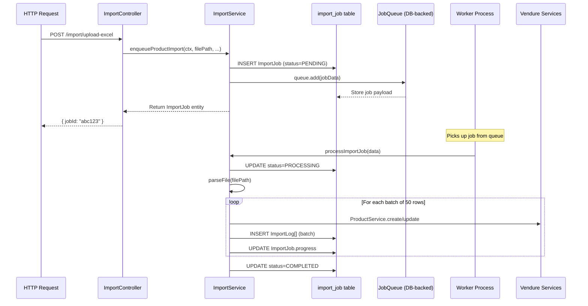
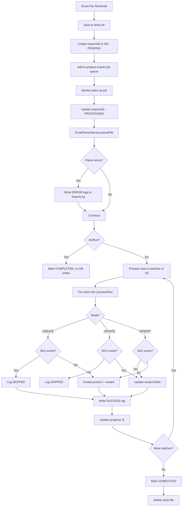
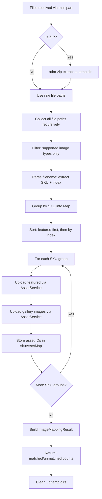
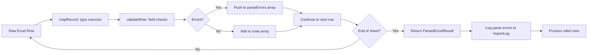
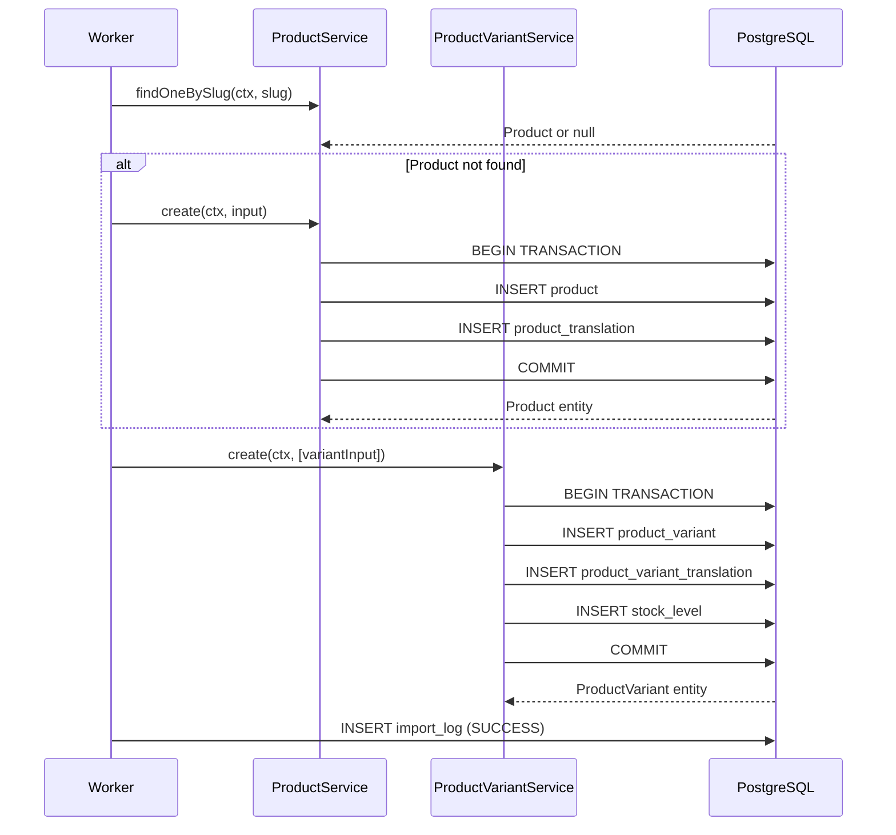
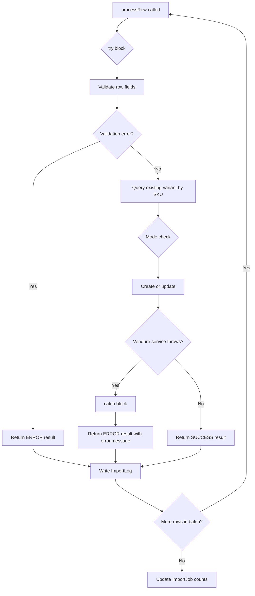

# Architecture Guide

> Deep-dive into the backend architecture, services, pipeline flow, and design decisions

---

## Table of Contents

- [Module Structure](#module-structure)
- [Service Layer](#service-layer)
- [REST Controller Layer](#rest-controller-layer)
- [GraphQL Resolver Layer](#graphql-resolver-layer)
- [Job Queue Architecture](#job-queue-architecture)
- [Import Pipeline](#import-pipeline)
- [Image Processing Pipeline](#image-processing-pipeline)
- [Validation Flow](#validation-flow)
- [Transaction Flow](#transaction-flow)
- [Error Handling Flow](#error-handling-flow)
- [Design Decisions](#design-decisions)

---

## Module Structure

```
product-import/
├── product-import.plugin.ts    ← @VendurePlugin + OnApplicationBootstrap
├── constants.ts                ← Shared constants (batch size, limits, job names)
├── types.ts                    ← Enums and interfaces (no classes)
│
├── entities/
│   ├── import-job.entity.ts    ← TypeORM entity: one per import operation
│   └── import-log.entity.ts    ← TypeORM entity: one per row processed
│
├── services/
│   ├── import.service.ts          ← Orchestrator: enqueue + process jobs
│   ├── excel-parser.service.ts    ← Parse .xlsx into ExcelProductRow[]
│   ├── excel-template.service.ts  ← Generate .xlsx template with styling
│   ├── asset-mapping.service.ts   ← Map SKU filenames to Vendure assets
│   └── import-history.service.ts  ← Query/cancel/report import jobs
│
├── api/
│   ├── api-extensions.ts          ← GraphQL schema additions (gql`...`)
│   ├── import.admin.resolver.ts   ← @Resolver for admin-api GraphQL
│   └── import.controller.ts       ← @Controller for REST /import/* routes
│
└── dashboard/
    ├── index.tsx                  ← defineDashboardExtension + nav items
    ├── pages/
    │   ├── ImportProductsPage.tsx
    │   ├── UploadImagesPage.tsx
    │   ├── ImportHistoryPage.tsx
    │   └── ImportDetailPage.tsx
    └── components/
        ├── FileUploadZone.tsx
        ├── ImportProgress.tsx
        └── ErrorViewer.tsx
```

---

## Service Layer

### `ImportService`

The central orchestrator. Responsibilities:

1. **Queue initialization** — Creates two job queues on bootstrap:
   - `product-import-job`: processes Excel files
   - `image-import-job`: processes image batches

2. **Job creation** — `enqueueProductImport()` saves an `ImportJob` entity and adds the job to the queue

3. **Background processing** — `processImportJob()` is the queue handler:
   - Parses the Excel file
   - Updates job progress in real-time
   - Processes rows in configurable batches
   - Writes per-row `ImportLog` records
   - Cleans up temp files on completion

4. **File utilities** — `saveUploadedFile()` streams multipart uploads to a temp path

**Key method signatures:**
```typescript
init(): Promise<void>
enqueueProductImport(ctx, filePath, fileName, mode, dryRun): Promise<ImportJob>
processImagesDirectly(ctx, filePaths, zipPath?): Promise<ImageMappingResult>
saveUploadedFile(stream, originalName): Promise<string>
```

---

### `ExcelParserService`

Stateless service that reads an `.xlsx` file using ExcelJS and returns structured data.

**Responsibilities:**
- Detect the correct data start row (skips instruction row 2)
- Unwrap ExcelJS rich-text and formula values
- Map column headers to typed `ExcelProductRow` objects
- Collect `customField_*` columns into a nested object
- Validate each row (required fields, slug format, price range)

**Key method:**
```typescript
parseFile(filePath: string): Promise<ParsedExcelResult>
```

**Output shape:**
```typescript
interface ParsedExcelResult {
  rows: ExcelProductRow[];
  errors: Array<{ row: number; message: string }>;
  totalRows: number;
}
```

---

### `ExcelTemplateService`

Generates a styled XLSX workbook with two sheets:
- **Products** — data entry sheet with frozen header row, blue/gray color-coded columns, data validation dropdowns, and three example rows
- **Instructions** — human-readable field guide with mode explanations

**Key method:**
```typescript
generateTemplate(): Promise<Buffer>
```

---

### `AssetMappingService`

Handles all image processing:

1. **ZIP extraction** — Uses `adm-zip` to recursively extract images to a temp directory
2. **Filename parsing** — Regex extracts SKU and gallery index from each filename
3. **SKU→image mapping** — Returns `Map<sku, MappedImage[]>` ordered by featured first
4. **Asset upload** — Calls `AssetService.create()` for each image file
5. **Result aggregation** — Counts matched/unmatched files, returns `ImageMappingResult`

**Key method:**
```typescript
processImages(ctx, filePaths, zipPath?):
  Promise<{ result: ImageMappingResult; skuAssetMap: Map<string, {...}> }>
```

---

### `ImportHistoryService`

Read-only query service for the import audit log:

```typescript
findAll(ctx, options?): Promise<PaginatedList<ImportJob>>
findOne(ctx, id): Promise<ImportJob | null>
getLogs(ctx, jobId, take, skip): Promise<ImportLog[]>
cancelJob(ctx, id): Promise<ImportJob>
getErrorReport(ctx, jobId): Promise<ErrorRow[]>
```

---

## REST Controller Layer

`ImportController` exposes multipart file upload endpoints that the GraphQL layer cannot handle efficiently for large files (GraphQL's `Upload` scalar buffers entire files in memory).

**Design choice:** Use REST for file uploads, GraphQL for data queries. This allows:
- Multer disk storage (files written to disk, not buffered in RAM)
- Streaming large files without memory spikes
- Standard HTTP progress tracking on the client

```typescript
@Controller('import')
export class ImportController {
  @Get('template')     downloadTemplate()
  @Post('upload-excel') uploadExcel(@UploadedFile() file)
  @Post('upload-images') uploadImages(@UploadedFiles() files)
  @Get('jobs')          listJobs()
  @Get('jobs/:id')      getJob()
  @Get('jobs/:id/error-report') getErrorReport()
}
```

---

## GraphQL Resolver Layer

`ImportAdminResolver` handles queries and mutations via the Vendure admin GraphQL API. File upload mutations (`uploadProductExcel`, `uploadProductImages`) throw an explanatory error redirecting callers to the REST endpoints.

```typescript
@Resolver()
export class ImportAdminResolver {
  @Query() importJobs()
  @Query() importJob()
  @Query() importJobLogs()
  @Query() importErrorReport()
  @Mutation() cancelImportJob()
}
```

---

## Job Queue Architecture



### Queue Configuration

The plugin uses Vendure's `DefaultJobQueuePlugin` which stores jobs in PostgreSQL. This means:

- **Jobs survive server restarts** — no job loss if the server crashes mid-import
- **No additional infrastructure** — no Redis or BullMQ needed for the queue itself
- **Single-node concurrency** — jobs processed one at a time per worker process
- **Multi-worker scaling** — run multiple worker processes for parallel job processing

---

## Import Pipeline



---

## Image Processing Pipeline



---

## Validation Flow



**Validation checks (per row):**

| Check | Field | Error Message |
|---|---|---|
| Required | `productName` | `productName is required` |
| Required | `sku` | `sku is required` |
| Required | `slug` | `slug is required` |
| Format | `slug` | `slug contains invalid characters` |
| Range | `price` | `price cannot be negative` |

---

## Transaction Flow

Each row is processed in a try/catch. Rows are independent — a failure on row 47 does not roll back rows 1–46.



> Vendure's `ProductService` and `ProductVariantService` handle their own transactions internally. The import service does not wrap them in an outer transaction to avoid long-running locks on large imports.

---

## Error Handling Flow



**Error isolation guarantees:**
- A single row failure never aborts the entire import
- Each row's outcome is independently recorded in `ImportLog`
- The `ImportJob` reflects final aggregate counts after all rows are processed
- Fatal errors (e.g., file not found, DB connection lost) set `ImportJob.status = FAILED` and record the error message

---

## Design Decisions

### Why REST for file uploads, not GraphQL?

GraphQL's `Upload` scalar (from `graphql-upload`) buffers the entire file in memory before the resolver receives it. For a 50 MB Excel file with 100,000 rows this would exhaust Node.js heap. Using `@nestjs/platform-express` with Multer disk storage writes directly to the filesystem, keeping memory usage flat regardless of file size.

### Why not stream-parse Excel on the fly?

ExcelJS's streaming reader (`workbook.xlsx.createInputStream`) has limited API coverage — it cannot seek backwards to read headers after reading rows. The two-pass approach (read headers → read data) requires a seekable stream. Since files are written to disk anyway (via Multer), full-file parsing is used instead. For very large files (>100k rows), this is acceptable because ExcelJS reads one row at a time internally.

### Why batch size of 50?

50 rows per batch is a balance between:
- **Database round-trips:** Fewer batches = fewer progress-update writes
- **Transaction size:** Each row is independently committed — a batch of 50 keeps individual transaction time under 500ms
- **Progress granularity:** 50-row batches give smooth progress updates on files up to ~1000 rows

For large catalogs (100k+ rows), increase `BATCH_SIZE` to 200 in `constants.ts`.

### Why Vendure Job Queue over BullMQ?

`DefaultJobQueuePlugin` is already present in this project and stores jobs in PostgreSQL. Adding BullMQ would introduce a second infrastructure dependency (Redis) purely for job queuing. Since Redis is already used for caching, BullMQ is a viable upgrade path — but the built-in queue is sufficient for typical catalog sizes.

### Why per-row ImportLog (not aggregate)?

Per-row logs enable:
- Targeted retry (re-import only failed rows)
- Downloadable error reports with row numbers
- Granular audit trail for compliance
- Efficient filtering in the dashboard (show only ERROR rows)

The tradeoff is write amplification — a 100k-row import creates 100k `import_log` records. Mitigate with a periodic cleanup job (see [Maintenance Guide](./maintenance.md)).
