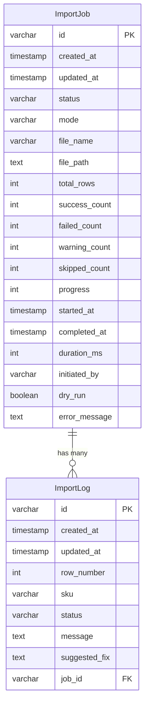

# Database Reference

> Entity definitions, relationships, migrations, and query patterns

---

## Table of Contents

- [Entity Overview](#entity-overview)
- [ImportJob Entity](#importjob-entity)
- [ImportLog Entity](#importlog-entity)
- [Entity Relationship Diagram](#entity-relationship-diagram)
- [Migrations](#migrations)
- [Indexes](#indexes)
- [Query Patterns](#query-patterns)
- [Data Retention](#data-retention)

---

## Entity Overview

The plugin adds two tables to the database:

| Table | Rows per Import | Purpose |
|---|---|---|
| `import_job` | 1 | Tracks the overall import operation |
| `import_log` | 1 per Excel row | Records the outcome of each processed row |

Both entities extend Vendure's `VendureEntity` base class, which provides:
- `id` — `varchar` primary key (auto-generated nanoid)
- `createdAt` — `TIMESTAMP`, set on insert
- `updatedAt` — `TIMESTAMP`, set on insert and every update

---

## ImportJob Entity

### TypeORM Definition

```typescript
@Entity()
export class ImportJob extends VendureEntity {
    @Column({ type: 'varchar', default: 'PENDING' })
    status: ImportJobStatus;   // PENDING | PROCESSING | COMPLETED | FAILED | CANCELLED

    @Column({ type: 'varchar', default: 'UPSERT' })
    mode: ImportMode;          // CREATE | UPDATE | UPSERT

    @Column()
    fileName: string;          // Original filename from multipart upload

    @Column({ nullable: true, type: 'text' })
    filePath: string;          // Temp file path (deleted after processing)

    @Column({ default: 0 })
    totalRows: number;         // Set after Excel parsing

    @Column({ default: 0 })
    successCount: number;

    @Column({ default: 0 })
    failedCount: number;

    @Column({ default: 0 })
    warningCount: number;

    @Column({ default: 0 })
    skippedCount: number;

    @Column({ default: 0 })
    progress: number;          // 0–100 (percentage)

    @Column({ nullable: true, type: 'timestamp' })
    startedAt: Date | null;   // Set when worker picks up the job

    @Column({ nullable: true, type: 'timestamp' })
    completedAt: Date | null;

    @Column({ nullable: true, type: 'int' })
    durationMs: number | null; // completedAt - startedAt in milliseconds

    @Column()
    initiatedBy: string;       // Admin user ID as string

    @Column({ default: false })
    dryRun: boolean;

    @Column({ nullable: true, type: 'text' })
    errorMessage: string | null;  // Set only on FAILED status

    @OneToMany(() => ImportLog, log => log.job, { cascade: true })
    logs: ImportLog[];
}
```

### Table: `import_job`

| Column | Type | Nullable | Default | Description |
|---|---|---|---|---|
| `id` | varchar | No | nanoid | Primary key |
| `created_at` | timestamp | No | NOW() | Creation time |
| `updated_at` | timestamp | No | NOW() | Last update time |
| `status` | varchar | No | `PENDING` | Job lifecycle state |
| `mode` | varchar | No | `UPSERT` | Import mode |
| `file_name` | varchar | No | — | Original filename |
| `file_path` | text | Yes | NULL | Temp file location |
| `total_rows` | int | No | 0 | Total Excel rows parsed |
| `success_count` | int | No | 0 | Rows successfully processed |
| `failed_count` | int | No | 0 | Rows that errored |
| `warning_count` | int | No | 0 | Rows with warnings |
| `skipped_count` | int | No | 0 | Rows intentionally skipped |
| `progress` | int | No | 0 | Progress percentage 0–100 |
| `started_at` | timestamp | Yes | NULL | Worker start time |
| `completed_at` | timestamp | Yes | NULL | Completion time |
| `duration_ms` | int | Yes | NULL | Total duration in ms |
| `initiated_by` | varchar | No | — | Admin user ID |
| `dry_run` | boolean | No | false | Dry run flag |
| `error_message` | text | Yes | NULL | Fatal error message |

---

## ImportLog Entity

### TypeORM Definition

```typescript
@Entity()
export class ImportLog extends VendureEntity {
    @Column({ default: 0 })
    rowNumber: number;         // Excel row number (including header rows)

    @Column({ nullable: true, type: 'varchar' })
    sku: string | null;        // SKU from that row (null for parse-level errors)

    @Column({ type: 'varchar', default: 'ERROR' })
    status: ImportLogStatus;   // SUCCESS | ERROR | WARNING | SKIPPED

    @Column({ type: 'text' })
    message: string;           // Human-readable outcome description

    @Column({ nullable: true, type: 'text' })
    suggestedFix: string | null;  // Actionable fix guidance

    @EntityId()
    jobId: ID;

    @ManyToOne(() => ImportJob, job => job.logs, { onDelete: 'CASCADE' })
    @JoinColumn({ name: 'jobId' })
    job: ImportJob;
}
```

### Table: `import_log`

| Column | Type | Nullable | Default | Description |
|---|---|---|---|---|
| `id` | varchar | No | nanoid | Primary key |
| `created_at` | timestamp | No | NOW() | Creation time |
| `updated_at` | timestamp | No | NOW() | Last update time |
| `row_number` | int | No | 0 | Source Excel row number |
| `sku` | varchar | Yes | NULL | SKU from that row |
| `status` | varchar | No | `ERROR` | Row outcome |
| `message` | text | No | — | Outcome description |
| `suggested_fix` | text | Yes | NULL | Fix guidance |
| `job_id` | varchar | No | — | FK to import_job.id |

---

## Entity Relationship Diagram



---

## Migrations

### Migration File

`src/migrations/1778000000000-product-import.ts`

**Up migration:**
1. Creates `import_job` table with all columns and constraints
2. Creates `import_log` table with FK to `import_job`
3. Creates three indexes

**Down migration:**
1. Drops all indexes
2. Drops `import_log` (logs reference jobs via FK)
3. Drops `import_job`

### Running Migrations

```bash
# Apply
npm run migration:run

# Rollback
npm run migration:revert
```

---

## Indexes

| Index Name | Table | Column | Purpose |
|---|---|---|---|
| `PK_import_job` | import_job | id | Primary key lookup |
| `PK_import_log` | import_log | id | Primary key lookup |
| `FK_import_log_job` | import_log | job_id | FK enforcement |
| `IDX_import_job_status` | import_job | status | Filter by status (dashboard list) |
| `IDX_import_job_created_at` | import_job | created_at | Sort by date (dashboard list) |
| `IDX_import_log_job_id` | import_log | job_id | Join from job to logs |

---

## Query Patterns

### List Jobs (Dashboard History)

```sql
SELECT *
FROM import_job
ORDER BY created_at DESC
LIMIT 50;
```

Uses: `IDX_import_job_created_at`

---

### Filter Active Jobs

```sql
SELECT *
FROM import_job
WHERE status IN ('PENDING', 'PROCESSING')
ORDER BY created_at ASC;
```

Uses: `IDX_import_job_status`

---

### Job Detail with Logs

```sql
SELECT j.*,
       l.id AS log_id,
       l.row_number,
       l.sku,
       l.status AS log_status,
       l.message,
       l.suggested_fix
FROM import_job j
LEFT JOIN import_log l ON l.job_id = j.id
WHERE j.id = 'abc123'
ORDER BY l.row_number ASC;
```

Uses: `IDX_import_log_job_id`

---

### Error Report

```sql
SELECT row_number, sku, message AS error, suggested_fix
FROM import_log
WHERE job_id = 'abc123'
  AND status = 'ERROR'
ORDER BY row_number ASC;
```

Uses: `IDX_import_log_job_id`

---

### Aggregate Statistics

```sql
SELECT
    mode,
    status,
    COUNT(*) AS job_count,
    AVG(total_rows) AS avg_rows,
    AVG(duration_ms) / 1000.0 AS avg_duration_seconds,
    SUM(success_count) AS total_successes,
    SUM(failed_count) AS total_failures
FROM import_job
WHERE created_at > NOW() - INTERVAL '30 days'
GROUP BY mode, status
ORDER BY mode, status;
```

---

## Data Retention

### Default Retention

There is no automatic cleanup. Import jobs and logs accumulate indefinitely.

### Estimating Storage

| Import Size | ImportLog Records | Estimated Row Size | Total Storage |
|---|---|---|---|
| 1,000 rows | 1,000 | ~300 bytes | ~300 KB |
| 10,000 rows | 10,000 | ~300 bytes | ~3 MB |
| 100,000 rows | 100,000 | ~300 bytes | ~30 MB |
| Daily imports of 10k rows, 1 year | 3.65M | ~300 bytes | ~1 GB |

### Cleanup Query

```sql
-- Delete completed/failed/cancelled jobs older than 90 days
-- import_log records cascade-delete automatically via FK ON DELETE CASCADE
DELETE FROM import_job
WHERE created_at < NOW() - INTERVAL '90 days'
  AND status IN ('COMPLETED', 'FAILED', 'CANCELLED');
```

### Archiving Strategy

For compliance, archive before deletion:

```bash
# Export old records to CSV
psql -d vendure -c "\COPY (
  SELECT * FROM import_job
  WHERE created_at < NOW() - INTERVAL '90 days'
) TO '/backups/import_job_archive_$(date +%Y%m).csv' CSV HEADER;"

# Then delete
psql -d vendure -c "
DELETE FROM import_job
WHERE created_at < NOW() - INTERVAL '90 days'
  AND status IN ('COMPLETED', 'FAILED', 'CANCELLED');
"
```
