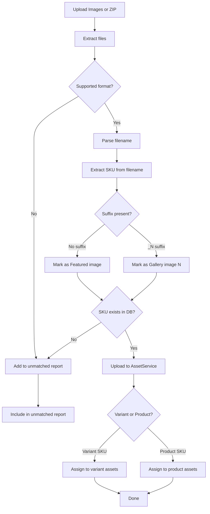

# Image Mapping Guide

> Complete reference for bulk image uploads and automatic SKU-based image mapping

---

## Table of Contents

- [How Image Mapping Works](#how-image-mapping-works)
- [Filename Conventions](#filename-conventions)
- [SKU Matching Logic](#sku-matching-logic)
- [Featured vs Gallery Images](#featured-vs-gallery-images)
- [ZIP Archive Handling](#zip-archive-handling)
- [Variant-Level Image Assignment](#variant-level-image-assignment)
- [Unsupported File Handling](#unsupported-file-handling)
- [Duplicate Image Handling](#duplicate-image-handling)
- [Unmatched Image Report](#unmatched-image-report)
- [Complete Examples](#complete-examples)

---

## How Image Mapping Works

The image mapping system uses **filename-based SKU matching** to automatically associate uploaded images with the correct products and variants in Vendure.



---

## Filename Conventions

### Basic Pattern

```
{SKU}[_{index}].{extension}
```

| Filename | SKU | Type | Index |
|---|---|---|---|
| `ST1234.jpg` | `ST1234` | Featured | — |
| `ST1234_1.jpg` | `ST1234` | Gallery | 1 |
| `ST1234_2.jpg` | `ST1234` | Gallery | 2 |
| `ST1234_3.png` | `ST1234` | Gallery | 3 |

### Rules

1. **No suffix** (e.g. `ST1234.jpg`) → **Featured image** for that SKU
2. **Numeric suffix** `_1`, `_2`, `_3` → **Gallery images** in ascending order
3. Matching is **case-insensitive** — `st1234.jpg` matches SKU `ST1234`
4. Supported extensions: `.jpg`, `.jpeg`, `.png`, `.gif`, `.webp`, `.svg`
5. All other file types are ignored and reported

---

## SKU Matching Logic

The parser extracts the SKU from the filename using a regular expression:

```
Pattern: ^(.+?)(?:_(\d+))?$   (applied to basename without extension)
```

### Extraction Examples

| Filename | Basename | Extracted SKU | Extracted Index |
|---|---|---|---|
| `ST1234.jpg` | `ST1234` | `ST1234` | none → featured |
| `ST1234_1.jpg` | `ST1234_1` | `ST1234` | `1` → gallery |
| `ST1234_10.jpg` | `ST1234_10` | `ST1234` | `10` → gallery |
| `CABLE-002.png` | `CABLE-002` | `CABLE-002` | none → featured |
| `CABLE-002_2.png` | `CABLE-002_2` | `CABLE-002` | `2` → gallery |
| `LAP-15-16GB.webp` | `LAP-15-16GB` | `LAP-15-16GB` | none → featured |
| `LAP-15-16GB_1.jpg` | `LAP-15-16GB_1` | `LAP-15-16GB` | `1` → gallery |

### Edge Cases

| Filename | Behavior |
|---|---|
| `st1234.JPG` | Matched to `ST1234` — extension case-insensitive |
| `ST1234.bmp` | Ignored — `.bmp` not in supported list |
| `product_image.jpg` | SKU = `product`, may or may not match |
| `2024_product_1.jpg` | SKU = `2024_product`, index = `1` |
| `IMG_1234.jpg` | SKU = `IMG`, index = `1234` — likely unmatched |

> **Tip:** Avoid filenames like `IMG_1234.jpg` from cameras. Rename files to match your SKU scheme before uploading.

---

## Featured vs Gallery Images

### Featured Image Rules

- The file **without a numeric suffix** becomes the featured image
- Example: `ST1234.jpg` → `product.featuredAsset`
- Only **one featured image** per SKU is recognized
- If multiple unsuffixed files match the same SKU, the last one processed wins (avoid this)

### Gallery Image Rules

- Files with `_1`, `_2`, `_3` suffixes become gallery assets
- Appended to `product.assets[]` in **numeric order**
- Multiple gallery images per SKU are supported
- No practical upper limit on gallery image count

### Order Guarantee

Images are sorted before upload:

```
ST1234.jpg    → position 0 (featured)
ST1234_1.jpg  → position 1
ST1234_2.jpg  → position 2
ST1234_3.jpg  → position 3
```

---

## ZIP Archive Handling

For large batches of images (100+), uploading a ZIP archive is the most efficient approach.

### How ZIP Extraction Works

1. ZIP is saved to a temporary directory
2. `adm-zip` extracts all contents recursively
3. All files (including those in subdirectories) are collected
4. Each file is processed through the normal SKU matching pipeline
5. The temp directory is cleaned up after processing

### ZIP Structure (Supported)

**Flat structure (recommended):**
```
images.zip
├── ST1234.jpg
├── ST1234_1.jpg
├── CABLE-002.jpg
└── TS-BLK.png
```

**Nested structure (supported, but not recommended):**
```
images.zip
├── headphones/
│   ├── ST1234.jpg
│   └── ST1234_1.jpg
└── cables/
    └── CABLE-002.jpg
```

> Files in subdirectories are discovered recursively. The directory path is ignored — only the filename is used for SKU matching.

### ZIP Best Practices

- Use flat structure (no subdirectories) for simplicity
- Avoid including non-image files in the ZIP (they appear in the unmatched report)
- Maximum recommended ZIP size: 500 MB
- Test with a small ZIP first (10–20 images)

---

## Variant-Level Image Assignment

Vendure's data model allows assets at both the **product level** and the **variant level**. The import system assigns images as follows:

| Scenario | Assignment |
|---|---|
| SKU matches a **product variant** | Images assigned to that specific variant |
| SKU matches a **product** (no variant match) | Images assigned to the product |
| No match found | Added to unmatched report |

### Practical Example

Assume the database has:
- Product: `Wireless Headphones Pro` (slug: `wireless-headphones-pro`)
  - Variant 1: SKU `WHP-BLK`, Name: "Black"
  - Variant 2: SKU `WHP-WHT`, Name: "White"

Uploading these files:
```
WHP-BLK.jpg      → featured image for variant WHP-BLK
WHP-BLK_1.jpg    → gallery image for variant WHP-BLK
WHP-WHT.jpg      → featured image for variant WHP-WHT
WHP-WHT_1.jpg    → gallery image for variant WHP-WHT
```

Each variant gets its own independent set of images.

---

## Unsupported File Handling

Files that cannot be processed are tracked and reported:

### Unsupported Conditions

| Condition | Example | Behavior |
|---|---|---|
| Unsupported extension | `product.bmp`, `data.pdf` | Added to unmatched list |
| No SKU match | `IMG_001.jpg` | Added to unmatched list |
| Corrupt/empty file | Zero-byte `.jpg` | Upload fails silently, logged |
| System files | `.DS_Store`, `Thumbs.db` | Ignored |

### Supported Image Formats

| Extension | MIME Type |
|---|---|
| `.jpg` / `.jpeg` | `image/jpeg` |
| `.png` | `image/png` |
| `.gif` | `image/gif` |
| `.webp` | `image/webp` |
| `.svg` | `image/svg+xml` |

---

## Duplicate Image Handling

### Same SKU Uploaded Twice

If you upload the same image (same filename, same SKU) twice:
- The second upload creates a **new asset** in Vendure's asset library
- The new asset replaces the old featured asset reference
- The old asset remains in the library (Vendure does not auto-delete orphaned assets)

**Recommendation:** Clean up duplicate assets via the Vendure admin Assets panel after large re-uploads.

### Multiple Featured Images for One SKU

If two files without a suffix map to the same SKU (e.g., uploading `ST1234.jpg` twice in one batch):
- The system processes them in the order found
- The **last one wins** as the featured asset

---

## Unmatched Image Report

After every image upload, the API response and dashboard both show an unmatched files list.

### Dashboard View

```
Upload Result
─────────────────────────────────
✓ 847   Matched
⚠  12   Unmatched
─  859  Total

Unmatched Files
────────────────────────────────────────────
✗ IMG_001.jpg        ← no SKU match
✗ IMG_002.jpg
✗ thumbnail_small.png
✗ banner-hero.jpg
✗ .DS_Store          ← system file
```

### API Response

```json
{
  "success": true,
  "matched": 847,
  "unmatched": 12,
  "total": 859,
  "unmatchedFiles": [
    "IMG_001.jpg",
    "IMG_002.jpg",
    "thumbnail_small.png",
    "banner-hero.jpg",
    ".DS_Store"
  ],
  "errors": []
}
```

---

## Complete Examples

### Example 1: Single Product, Multiple Images

**Files to upload:**
```
ST1234.jpg       ← featured
ST1234_1.jpg     ← gallery 1
ST1234_2.jpg     ← gallery 2
ST1234_3.jpg     ← gallery 3
```

**Result:**
- `product.featuredAsset` = uploaded ST1234.jpg
- `product.assets` = [ST1234_1.jpg, ST1234_2.jpg, ST1234_3.jpg]

---

### Example 2: Multi-Variant Product

**SKUs:** `TS-BLK`, `TS-WHT`, `TS-RED`

**Files:**
```
TS-BLK.jpg
TS-BLK_1.jpg
TS-WHT.jpg
TS-RED.jpg
TS-RED_1.jpg
TS-RED_2.jpg
```

**Result:**
| SKU | Featured | Gallery |
|---|---|---|
| TS-BLK | TS-BLK.jpg | [TS-BLK_1.jpg] |
| TS-WHT | TS-WHT.jpg | [] |
| TS-RED | TS-RED.jpg | [TS-RED_1.jpg, TS-RED_2.jpg] |

---

### Example 3: Mixed File Types in ZIP

**ZIP contents:**
```
products.zip
├── ST1234.jpg        ← will be matched
├── ST1234_1.jpg      ← will be matched
├── CABLE-002.png     ← will be matched
├── notes.txt         ← unmatched (unsupported type)
├── .DS_Store         ← unmatched (system file)
└── IMG_9987.jpg      ← unmatched (no SKU match)
```

**Result:** 3 matched, 3 unmatched

---

### Example 4: Large Catalog (1000 SKUs)

**Recommended workflow:**
1. Generate filenames programmatically using your SKU list
2. Create a single ZIP archive
3. Upload the ZIP — the system handles extraction automatically
4. Review the unmatched report and investigate any gaps

**Shell script to batch-rename photos:**
```bash
#!/bin/bash
# Rename camera files to SKU names
# Assumes a CSV: camera_filename,sku
while IFS=, read -r old_name sku; do
    ext="${old_name##*.}"
    mv "$old_name" "${sku}.${ext}"
done < sku_mapping.csv
```
